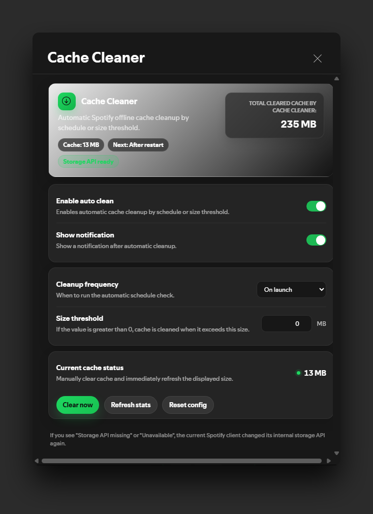

<div align="center">

# 🧹 mkAutoCacheCleaner 🧹

**A lightweight Spicetify extension that cleans Spotify offline cache**  
*Install it, configure it, and let it run in the background.*

<p>
  
  
  <a href="http://www.wtfpl.net/">
    
  </a>
</p>



</div>

## ⚡ Description

**mkAutoCacheCleaner** is a single-file Spicetify extension that adds a **Cache Cleaner** entry to the Spotify profile menu.

The extension provides a modal where you can enable automatic cache cleanup, choose a cleanup schedule, set a cache-size threshold, and run cleanup manually. Settings are stored in `Spicetify.LocalStorage`, so they persist after restarting Spotify.

---

## 🔥 Features

* **Manual cleanup:** run cleanup with the `Clear now` button.
* **Automatic cleanup:** choose `On launch`, `Daily`, `Weekly`, `Monthly`, or `Never`.
* **Size threshold:** clean cache only when it exceeds the configured size in MB.
* **Notifications:** enable or disable toast notifications after automatic cleanup.
* **API status:** shows whether the storage API was found in the current Spotify client.
* **Total cleared:** tracks how much cache Cache Cleaner has actually removed.
* **RU/EN localization:** the extension switches between Russian and English based on the Spotify UI language.

---

## 🚀 Installation

### 1. Copy the extension to the Spicetify extensions folder

**Windows:**
```powershell
Copy-Item .\autoCacheCleaner.js "$env:APPDATA\spicetify\Extensions\autoCacheCleaner.js"
```

**Linux / macOS:**
```bash
cp autoCacheCleaner.js ~/.config/spicetify/Extensions/autoCacheCleaner.js
```

### 2. Enable the extension

```bash
spicetify config extensions autoCacheCleaner.js
spicetify apply
```

After Spotify restarts, open the profile menu and select **Cache Cleaner**.

---

## ⚙️ Settings

| Setting | Description |
| :--- | :--- |
| `Enable auto clean` | Enables or disables automatic cleanup |
| `Show notification` | Shows notifications after automatic cleanup |
| `Cleanup frequency` | Selects the schedule: launch/daily/weekly/monthly/never |
| `Size threshold` | Cleans cache when it exceeds the configured size in MB; `0` disables the threshold |
| `Clear now` | Runs cleanup manually |
| `Refresh stats` | Refreshes the displayed cache size |
| `Reset config` | Resets settings to defaults |
| `Total cleared cache by Cache Cleaner` | Shows the total amount of cache actually removed by the extension |

Configuration is stored in `Spicetify.LocalStorage` under this key:

```text
mkultra69:cache-cleaner:config:v2
```

---

## 🛠️ How It Works

The extension waits for the Spicetify API to load, adds **Cache Cleaner** to the Spotify profile menu, and checks automatic cleanup conditions once per minute.

If `Size threshold` is enabled, cleanup can run independently of the selected schedule. If the storage API does not remove anything, the next threshold-based attempt is delayed for about one hour to avoid repeatedly hitting Spotify internals.

---

## ⚠️ Important

This extension uses internal `Spicetify.Platform` / Spotify storage APIs:

```js
Spicetify.Platform?.OfflineAPI?._storage
Spicetify.Platform?.Offline?._storageService
Spicetify.Platform?.Offline?._storage
```

These APIs are not public or stable. If Spotify changes its internal client structure, the modal may show **Storage API missing** or **Unavailable**. In that case, the extension cannot clean cache until a new storage API path is found.

If `spicetify config extensions` already shows `autoCacheCleaner.js` but the extension does not appear in Spotify, check that the file is actually located here:

```text
%APPDATA%\spicetify\Extensions\autoCacheCleaner.js
```

---

## 🧪 Verification

Quick syntax check:

```bash
node --check autoCacheCleaner.js
```

Apply changes to Spotify:

```bash
spicetify apply
```

---

## 💀 Credits & License

**Author:** MKultra69

### 📜 License

This project is distributed under the **WTFPL** (Do What The Fuck You Want To Public License).
